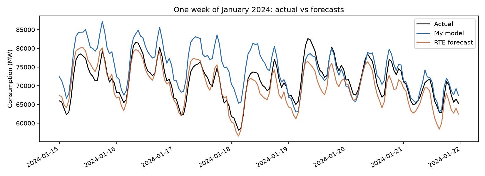
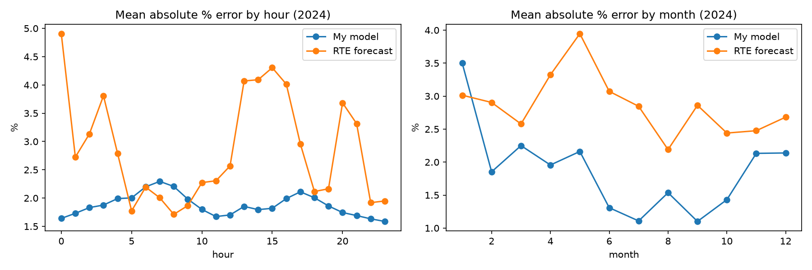
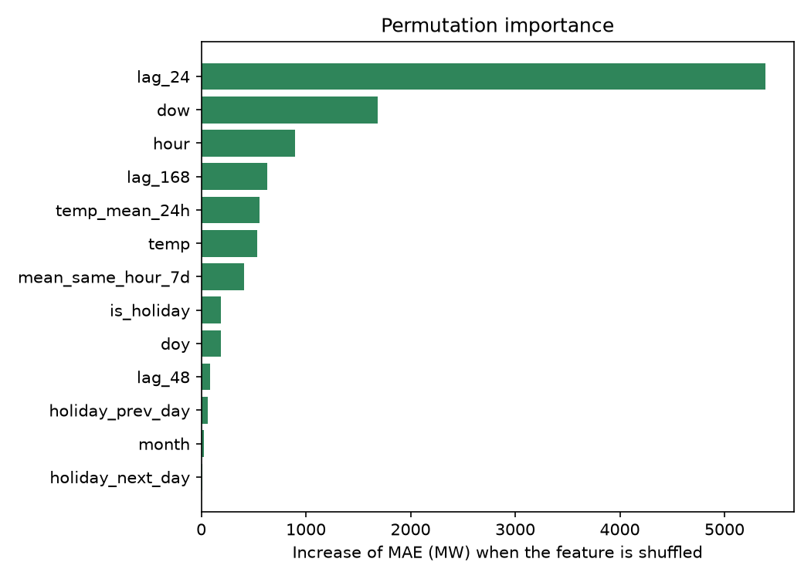

# Day-Ahead Forecast of French Electricity Consumption

[](https://github.com/BilalBess/energy-demand-forecasting/actions/workflows/ci.yml)

Time series project: forecast the **hourly electricity consumption of France** for the next day, compare several models with a strict time-based evaluation, and benchmark against the official forecast published by RTE (the grid operator).

## Problem
Electricity cannot be stored easily, so the grid operator must forecast demand. Every day at midnight, I forecast the 24 hours of the day that starts, using only information available at that moment.

## Data
- **Consumption**: RTE eco2mix national data (open data, `odre.opendatasoft.com`), 2018-2024, aggregated to hourly values. The file also contains the official RTE day-ahead forecast (`prevision_j1`), which I use as a benchmark.
- **Temperature**: Open-Meteo historical archive, hourly, for Paris (one point used as a proxy for the whole country).
- **French public holidays**: `holidays` Python package.

Hours with missing values (224 of about 61,400) are removed, the same hours for every model so the comparison is fair.

## Method
1. **Features** (all computed to respect the midnight rule): hour, day of week, month, day of year, holiday flags (today, day before, day after), consumption lagged by 24h, 48h and 168h, mean of the same hour over the last 7 days, temperature and its 24h mean.
2. **Time-based split** (never random for time series): train 2018-2022, validation 2023 (to choose hyper-parameters), final training on 2018-2023, **test on 2024**.
3. **Models**: two naive baselines (same hour yesterday / last week), Ridge regression with calendar dummies and a "heat/cold" temperature shape, and a gradient boosting model (`HistGradientBoostingRegressor`).
4. **Benchmark**: the RTE official forecast on the same test hours.
5. **Error analysis** by hour, by month and on holidays, then permutation importance.

## Results on 2024 (test set, about 8,700 hours)
| Model | MAE (MW) | RMSE (MW) | MAPE |
|---|---|---|---|
| Same hour last week | 3,248 | 4,859 | 6.09% |
| Same hour yesterday | 2,533 | 3,665 | 5.11% |
| Ridge (linear) | 1,486 | 2,037 | 3.04% |
| RTE official day-ahead forecast | 1,429 | 1,766 | 2.86% |
| **Gradient boosting (observed temperature)** | **972** | **1,416** | **1.88%** |
| Gradient boosting, no temperature | 1,282 | 1,864 | 2.45% |



### What I learned
- Simple baselines are far from good (5-6% error), but a model using **yesterday's load + calendar** already gets to about 2.5% without any weather.
- **Temperature helps** (2.45% to 1.88%). Consumption has a U-shape against temperature (heating in winter, a smaller effect of air conditioning in summer).
- **Holidays are the hardest days**: the error is about 3.0% on holidays against 1.8% on normal days, and the RTE forecast also has a larger error on these days (4.7%).
- The most important feature is yesterday's load at the same hour, then the day of the week and the hour.

### Please read before comparing with RTE
My model beating RTE (1.88% vs 2.86%) is **not a fair fight**, and I do not claim to be better than RTE:
- I use the **observed** temperature as if it were a perfect weather forecast. In real life the forecast error would add noise. The "no temperature" row (2.45%) is the more honest number.
- My forecast is issued at midnight, using all of the previous day's data. RTE's day-ahead forecast is produced earlier in the day (so it has less recent information).
- RTE forecasts for the whole country with detailed weather over many regions, I use only Paris.

The honest conclusion is: with simple features and a gradient boosting model, one gets in the same range as the official forecast, which shows how much of the signal is calendar and recent load.




## Limitations
- Observed weather instead of forecast weather (see above), and a single city.
- January 2024 has the highest error (3.5%). I did not investigate the cause (a cold spell is a possible reason).
- 2020 (Covid lockdowns) is kept in the training data. A test without 2020 could be done.
- Only one test year and one split. A rolling-origin evaluation (re-train every month) would be more robust.
- Point forecasts only. In practice, prediction intervals (quantile regression) are useful for the grid operator.

## How to run
```bash
pip install -r requirements.txt
python src/forecast.py     # downloads data (about 10 MB), trains, writes reports/
```

## Tests
```bash
pip install pytest
pytest -q
```
The tests cover the lag features (no information from the future), holiday flags and the error metrics. They run on every push with GitHub Actions (`.github/workflows/ci.yml`: lint with ruff, then pytest).

## Skills shown
Time series feature engineering without leakage, time-based validation, baselines and benchmarks, gradient boosting, error analysis, being careful with claims.
